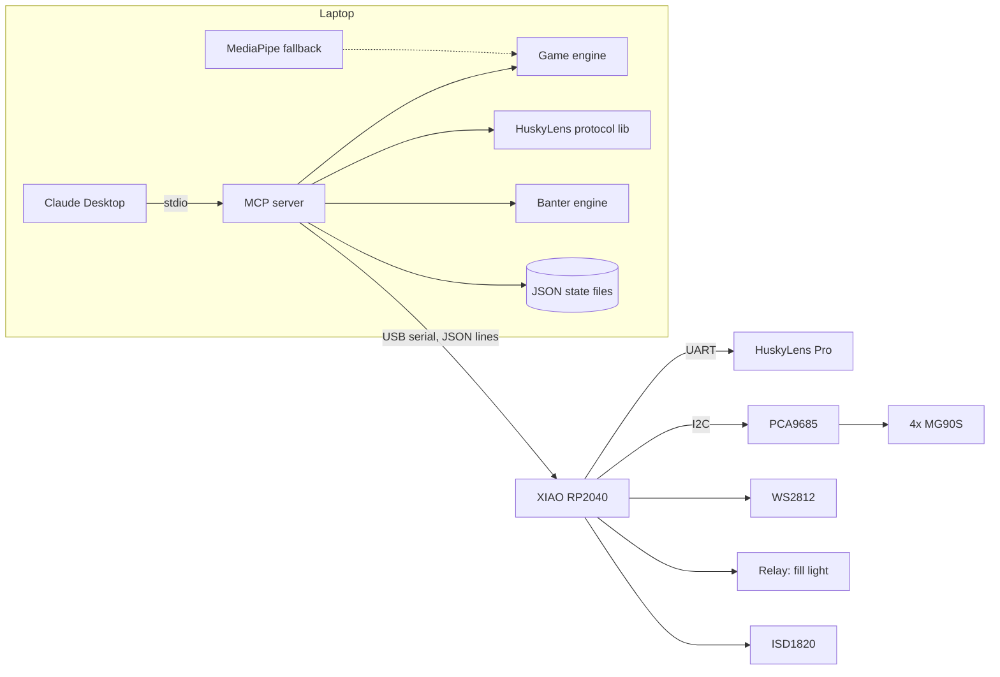
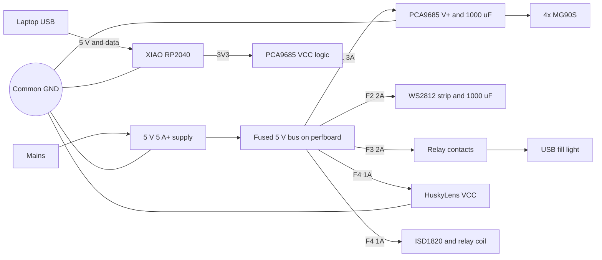
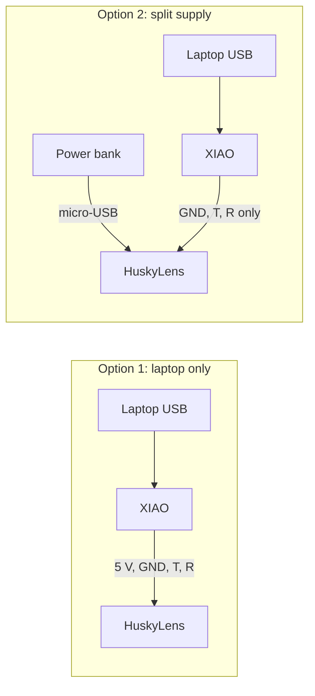
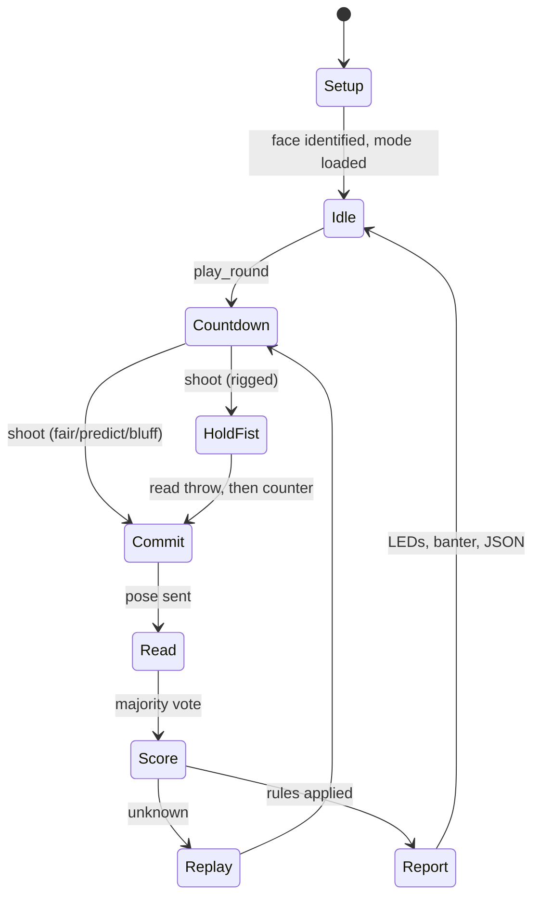
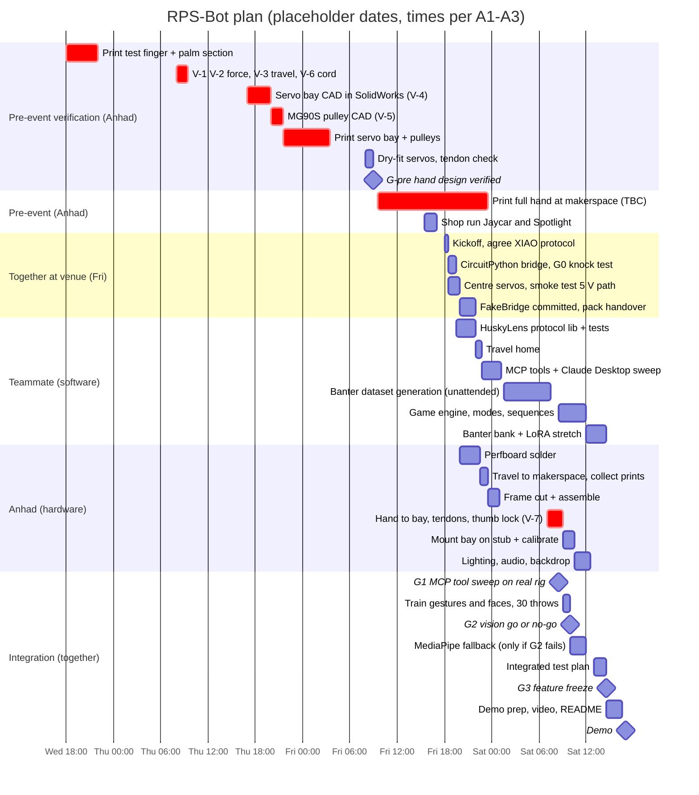

# RPS-Bot: MCP-Controlled Rock-Paper-Scissors Robot Hand

**Hackathon Design Document**

| Field | Value |
|---|---|
| Author | Anhad Ahuja |
| Team | Anhad (hardware lead), plus one teammate (software) |
| Version | 0.8 |
| Date | 20 November 2026 |
| Venue | 100 Wickham St, Fortitude Valley (hackathon); makerspace in Woolloongabba (printing, parking, workshop) |
| Duration | Friday evening to Saturday afternoon |
| Status | Draft for build. Items marked **TBC** still need confirmation |
| Revision history | §18 |

---

## 1. Summary

RPS-Bot is a 3D-printed, tendon-driven robot hand that plays rock-paper-scissors against a human. Its signature feature is a robot that *cheats in your favour, or against you*, depending on whose face it sees.

**How it works:**

- **Vision:** a DFRobot HuskyLens Pro (SEN0336) recognises the player's face during setup and their hand gesture during play.
- **Control:** a Seeed XIAO RP2040 drives four MG90S servos through a PCA9685, plus WS2812 LEDs, a relay-switched fill light and an ISD1820 voice module.
- **Orchestration:** a Python MCP server exposes every HuskyLens function and every actuator as tools. Claude can run the robot, train gestures and faces, and invent new moves and rules in conversation.
- **Commentary:** banter between rounds comes from a bank of lines generated by Claude. As a stretch goal, the bank is distilled into a small LoRA-tuned model that runs offline on a laptop.

**The work is staged:**

1. **Stage 1, platform:** an MCP server that can drive every HuskyLens protocol command and every actuator. This is the critical deliverable.
2. **Stage 2, game:** the game engine, modes, custom moves and banter.
3. **Fallback:** if the HuskyLens can't classify gestures reliably, swap to a phone camera feeding MediaPipe hand landmarks.

---

## 2. Scope and Assumptions

**In scope:**

- hand, servo bay and frame
- power distribution and the perfboard
- XIAO firmware, MCP server and game engine
- custom moves and banter
- the fallback vision path
- the demo

**Out of scope:**

- wrist or arm motion
- closed-loop finger sensing
- a finished enclosure

**Assumptions:**

| ID | Assumption | Status |
|---|---|---|
| A1 | Kickoff Fri 18:00, demo Sat 17:00. The Gantt (§12) uses these times on placeholder dates. | **TBC** |
| A2 | The teammate leaves the venue about 22:00 Fri. Anhad leaves about 22:30 for the makerspace or home. Both return about 08:00 Sat. | **TBC** |
| A3 | Prints run at the Woolloongabba makerspace. Pre-printing before kickoff depends on the hackathon rules. | **TBC** |
| A4 | Car available; no parking at the venue. Unload at the kerb and park at the makerspace (§11). | Confirmed |
| A5 | The HuskyLens Pro is on the latest firmware. | **TBC** (check with `husky_test.py`) |
| A6 | Each person has a Windows laptop. Anhad has no admin rights, so all tooling uses user-level installs. | Confirmed |
| A7 | The MCP client is Claude Desktop (stdio). The coding agent is Claude Code. | Assumed |

---

## 3. High-Level Objectives (HLOs)

| ID | Objective | Success measure |
|---|---|---|
| HLO-1 | Build an MCP server exposing 100 % of the HuskyLens protocol and all actuators as tools | Every command in protocol v0.5.1 is callable from Claude and returns a parsed result |
| HLO-2 | Build a printed hand that shows rock, paper and scissors unambiguously | A bystander identifies 10/10 random poses |
| HLO-3 | Recognise the human throw reliably | ≥ 85 % correct over 30 throws under demo lighting |
| HLO-4 | Play complete, scored, entertaining games | A best-of-5 runs end-to-end (countdown, audio, LEDs, banter, scoring) with no manual intervention |
| HLO-5 | Let users define moves, rules and rigged players through Claude | A new move and rule are created via chat and used in a game within 5 minutes |
| HLO-6 | Build a robust, safe, transportable rig | Mounted on 2020 extrusion, fused power, survives a car trip, passes a 30-minute soak test |

---

## 4. Requirements

Priority uses MoSCoW: **M** = must, **S** = should, **C** = could. Verification: **T** = test, **I** = inspection, **D** = demonstration, **A** = analysis.

### 4.1 Functional requirements

| ID | Requirement | Pri | Ver | HLO |
|---|---|---|---|---|
| FR-01 | The MCP server shall expose a tool for each HuskyLens protocol command (knock, requests 0x20–0x28, algorithm, learn, forget, names, photo, screenshot, model save/load, text, is-pro, firmware) | M | T | 1 |
| FR-02 | The MCP server shall provide a raw-frame escape hatch (`husky_raw`) | M | T | 1 |
| FR-03 | Responses shall be parsed into structured JSON (blocks, arrows, info, OK/BUSY/NEED_PRO) | M | T | 1 |
| FR-04 | The MCP server shall expose servo, pose, LED, relay, voice and speech tools | M | T | 1 |
| FR-05 | Each of the four finger channels shall reach visually distinct open and closed states | M | D | 2 |
| FR-06 | Pose transitions shall complete within 400 ms | S | T | 2,4 |
| FR-07 | The system shall classify the human throw as rock, paper, scissors, nothing or unknown | M | T | 3 |
| FR-08 | The game shall run a synchronised audio and LED countdown | M | D | 4 |
| FR-09 | In fair mode the robot shall commit its throw no later than "shoot" | M | T | 4 |
| FR-10 | The game shall track the score per player and per session | M | D | 4 |
| FR-11 | Users shall define custom moves (finger positions, LED colour, optional HuskyLens ID) via MCP | M | D | 5 |
| FR-12 | Users shall define custom win/lose rules | S | D | 5 |
| FR-13 | The system shall identify a registered player by face in a setup phase and apply that player's mode (§6, D10) | S | D | 4,5 |
| FR-14 | The game shall support fair, predict, rigged-win, rigged-lose and novelty modes | S | D | 4 |
| FR-15 | The game shall produce one banter line per round from game state, offline | S | D | 4 |
| FR-16 | The vision source shall be swappable (HuskyLens or MediaPipe) without changes to the game engine | S | I | 3 |
| FR-17 | Moves, rules, players, calibration and score history shall persist across restarts | S | T | 5 |
| FR-18 | Each MG90S channel shall fully close its finger(s) against the return cord with peak tendon force ≤ 60 % of servo stall force (V-1, V-2) | M | T | 2 |
| FR-19 | Claude shall be able to define, store, edit and play timed behaviour sequences (poses, LEDs, audio, waits) through MCP tools while the system runs, with no restart or recompile (D20) | S | D | 5 |
| FR-20 | The microcontroller firmware should be updatable in near real time, with no compile step (CircuitPython auto-reload, D3) | C | D | 5 |

### 4.2 Non-functional requirements

| ID | Requirement | Pri | Ver |
|---|---|---|---|
| NFR-01 | `play_round` shall return within 1.5 s of "shoot" | S | T |
| NFR-02 | Firmware shall reject malformed commands without crashing | M | T |
| NFR-03 | Every 5 V branch shall be individually fused | M | I |
| NFR-04 | All grounds shall be common, and only one source shall drive any 5 V net | M | I |
| NFR-05 | Servo travel shall be soft-limited to calibrated endpoints | M | T |
| NFR-06 | The rig shall survive transport: pluggable connectors and strain relief | S | I |
| NFR-07 | Software shall run without admin rights on Windows | M | D |
| NFR-08 | The software and hardware halves shall integrate through the documented XIAO command protocol (§9.2), so either half can be developed against a simulator | M | I |
| NFR-09 | No servo shall be held at a closed pose for more than 5 s; the hand relaxes between rounds | M | T |

### 4.3 Constraints

- **C-01:** MG90S micro servos only (four active, one spare).
- **C-02:** Controller: XIAO RP2040 (3.3 V logic) and PCA9685.
- **C-03:** Frame: 2020 aluminium extrusion.
- **C-04:** The HuskyLens firmware is closed; it's reachable only through its UART/I2C protocol.
- **C-05:** The ISD1820 stores one recording only.
- **C-06:** No parking at the venue; the car is based at the makerspace.

---

## 5. System Architecture



**One round, step by step:**

1. Claude calls `play_round`.
2. The engine triggers the LED countdown and the ISD1820 clip.
3. At "shoot", the engine commits the robot's move. In rigged-win mode it waits for the read instead (step 4).
4. The engine reads the human's throw by majority vote over about 300 ms.
5. The engine applies the rules, updates the score, generates a banter line and speaks it, then returns JSON.

Claude is not in the real-time loop.

---

## 6. Design Discussion

Each decision lists the options considered, then the selected option and the rationale.

### D1. Laptop-to-HuskyLens link topology

| Option | Pros | Cons |
|---|---|---|
| **A. XIAO acts as a bridge (USB → XIAO → UART → HuskyLens)** | One cable and one COM port; the XIAO is needed anyway | Firmware must forward frames |
| B. Separate USB-TTL adapter | Simplest path to the HuskyLens | Two COM ports; extra adapter |
| C. Raspberry Pi as host | Self-contained | Not on the BOM; OS setup risk |
| D. Mind+ online mode over USB | Official | Undocumented protocol; not scriptable |

**Selected: A.** The full protocol lives in Python on the laptop; the XIAO only forwards complete frames. During the overnight split, the software teammate can also use B (any USB-TTL adapter) if he doesn't take the XIAO (§11.3).

### D2. Laptop-to-XIAO protocol

| Option | Pros | Cons |
|---|---|---|
| **A. Newline-delimited JSON** | Readable; easy to simulate; easy to extend | Slightly larger messages (irrelevant at USB speeds) |
| B. Binary framing | Compact | Hard to debug |
| C. Firmata | Existing libraries | No HuskyLens pass-through |

**Selected: A.** This protocol is also the **integration contract between the two team members** (NFR-08). The command set is in §9.2.

### D3. Firmware framework

| Option | Pros | Cons |
|---|---|---|
| A. Arduino, Earle Philhower `arduino-pico` core | Mature; deterministic timing; hardware Serial1; PCA9685 and NeoPixel libraries | Every change needs a compile and flash (Claude Code can run `arduino-cli`, about 1 min); the USB link drops during a flash |
| **B. CircuitPython** | **Live updates:** firmware is `code.py` on the CIRCUITPY USB drive, and saving it auto-reloads the board in about 1–2 s, with no compiler; a second USB serial channel (`usb_cdc.data`, enabled in `boot.py`) carries the command protocol while the console/REPL stays free for Claude Code to inspect and poke the board live; appears as a USB drive with no driver installs (suits no-admin laptops); Python end-to-end for the team; libraries exist (`adafruit_pca9685` / `adafruit_servokit`, `neopixel`, `busio.UART`) | Auto-reload restarts the program (state loss is harmless, since state lives on the laptop); slower than C++, but trivial at these servo, LED and UART rates; the CIRCUITPY drive is read-only to the board's own code while the PC can write it |
| C. MicroPython | REPL; `mpremote exec` runs code without a reset | No USB-drive workflow; fewer ready-made drivers than CircuitPython |

**Selected: B (CircuitPython) as the preferred option, with A kept as a fully supported fallback.** The firmware is a thin bridge, so its performance doesn't matter. CircuitPython removes the compile/flash loop and lets Claude Code update the firmware almost live. The live-update ability is a nice-to-have (FR-20), not a requirement.

**Decision point:** at G0 (Fri 19:30). If the CircuitPython bridge passes the knock test and drives a servo, keep it. Otherwise flash the Arduino bridge sketch and continue. Both implement the same §9.2 command protocol, so the laptop side doesn't change.

### D4. MCP server stack

| Option | Pros | Cons |
|---|---|---|
| **A. Python `mcp` SDK (FastMCP), stdio** | Minimal; pyserial; Claude Desktop launches it directly | Laptop-tethered |
| B. Streamable HTTP | Remote access | Tunnel and auth needed |
| C. TypeScript SDK | Capable | Serial support is clunkier |

**Selected: A.** Keep the transport switchable so B can be a stretch goal.

### D5. Where the game loop runs

| Option | Pros | Cons |
|---|---|---|
| A. Claude orchestrates each step | Very agentic | Seconds of latency per call wreck the countdown |
| **B. Python engine; Claude calls `play_round` and the design tools** | Deterministic millisecond timing | Less live LLM involvement |
| C. Entirely in firmware | Lowest latency | Custom moves need reflashing |

**Selected: B.**

### D6. Hand design

| Option | Description | Pros | Cons |
|---|---|---|---|
| A. Custom 3-finger design | Own CAD | Fully controlled | CAD time on the critical path |
| B. Three single-finger modules (ARX, MakerWorld) | Proven fingers | Modular | Looks like a gripper, not a hand |
| C. Full guide build: hand + forearm + MG996R servo holder | Five-finger hand with the guide's forearm and 4× MG996R | Proven torque; no servo CAD | Needs 4× MG996R and about 10 A of servo power; the forearm isn't wanted |
| **D. Hand only from the guide (palm, fingers, thumb) + custom MG90S servo bay** | Five-finger hand; tendons run to our own SolidWorks bay on the 2020 frame | Reads clearly as RPS; uses the MG90S servos on hand; low power; no forearm | Servo bay and pulleys must be designed; MG90S torque against the 3 mm cord must be verified (§7.2) |

**Selected: D.**

**Sources:**

- Guide: [instructables.com/3D-Printed-Robotic-Arm-2](https://www.instructables.com/3D-Printed-Robotic-Arm-2)
- Files: [Thingiverse #3105948](https://www.thingiverse.com/thing:3105948), remixed from [MyMiniFactory #34508](https://www.myminifactory.com/object/3d-print-humanoid-robotic-hand-34508)

Only the palm, fingers and thumb are printed from the guide. The forearm, the MG996R servo holder and the 25T pulleys are not used.

**Thumb (decision confirmed):**

- **Curl only.** The thumb curls in, driven by its own MG90S on CH0 in the servo bay through a fishing-line tendon, exactly like the fingers. All four MG90S channels curl: thumb, index, middle, and ring+little.
- **No rotation.** Thumb rotation (opposition), the guide's palm-mounted MG90S, is **not used**. That servo is not fitted, and the thumb's rotation joint is locked at one fixed angle (setup guide in §7.1).
- **Why:** rock, paper and scissors only need curl/uncurl, so a fifth servo adds wiring and calibration for no benefit.

**Channel map:**

| Channel | Finger |
|---|---|
| CH0 | thumb (curl) |
| CH1 | index |
| CH2 | middle |
| CH3 | ring + little (shared pulley) |
| CH4 | spare (thumb rotation is not used) |

**Poses:**

| Pose | Fingers |
|---|---|
| Rock | all closed |
| Paper | all open |
| Scissors | index and middle open; thumb and ring+little closed |

Four channels give 2⁴ = 16 binary poses, minus physically awkward ones, for custom moves.

**Resolved items:**

- **H-1, servo fit:** in the guide, the four finger servos are MG996R in the forearm holder (25T horns). That holder is not used; the finger servos are MG90S in our own bay (D8).
- **H-2, opening mechanism:** 3 mm elastic nylon cord, threaded through holes in the back of the palm and fingers, returns each finger open. The fishing line closes it.

**Must-solve items** (verification plan in §7.2; scheduled in §12):

| ID | Item | Pass criterion |
|---|---|---|
| **V-1** | One-finger force test with 3 mm cord | Peak tendon force to fully close ≤ 60 % of MG90S stall force at the chosen pulley radius |
| **V-2** | Shared ring+little force test | Same criterion, with both fingers on one line |
| **V-3** | Tendon travel Δ per finger | Measured; sets the pulley radius (r ≈ Δ ÷ 2.6) |
| **V-4** | Servo bay design (SolidWorks) and print | 4× MG90S fit; tendons run straight from the wrist to the pulleys; mounts to the 2020 stub |
| **V-5** | MG90S pulley design and print | Fits the MG90S horn; clamps the line; radius from V-3 |
| **V-6** | 3 mm cord fits the printed holes | Threads without binding; otherwise switch to beading elastic (D7) |
| **V-7** | Thumb rotation locked; thumb curl works | The thumb curls fully on CH0 without colliding with the index finger; rock, paper and scissors all read clearly |
| **H-3** | Hand print time from the slicer | Fits the pre-print window (§11) |

### D7. Finger return element (elastic nylon cord, required by the design)

| Option | Pros | Cons |
|---|---|---|
| **A. 3 mm nylon shock cord (Textech, Whitworths, $17.95 / 20 m)** | The diameter the guide specifies; durable; plenty of length | Stiff, so it may overload an MG90S (V-1); online orders ship from Sydney (3–12 business days to QLD), so use click & collect or buy in store |
| B. 0.8–1 mm beading elastic ("stretch magic" style), Spotlight Windsor | Much lower force, which suits the MG90S; cheap; in store | Weaker return, so check that fingers still open fully; knots need CA glue |
| C. Rubber bands or hair ties (Kmart, BIG W) | Cheap; quick | Lose tension; force rises steeply; can snap |
| D. Small extension springs (Bunnings) | Consistent force | Need hook points |

**Selected: A, subject to V-1 and V-6.** If V-1 fails, reduce the pre-stretch first. If it still fails, switch to B. C is the on-the-night backup.

### D8. Servo bay and tendon pulleys

**Servo bay:**

| Option | Pros | Cons |
|---|---|---|
| A. Guide forearm and holder with MG996R | No CAD | Rejected: no forearm wanted; needs new servos and about 10 A |
| **B. Custom SolidWorks bay: 4× MG90S side by side on the 2020 stub, with a wrist guide plate that the palm bolts to** | Compact; uses MG90S; mounts straight to the frame; adjustable | CAD and print on the critical path |
| C. Servos inside the palm | Most compact | No room; tendons would need sharp bends |

**Selected: B.** Design spec:

- **Servo cutouts:** 4× MG90S, about 23 × 12.5 mm each with screw-tab bosses. Measure your servos and add 0.2–0.3 mm clearance. Leave 6–8 mm between servos for pulley clearance.
- **Wrist guide plate:**
  - Palm interface: match the guide's wrist hole pattern.
  - Tendon holes: Ø1.5–2 mm, one per channel, with rounded exits.
  - Path: the tendons run straight to each pulley's tangent point, with no bends sharper than about 30°.
- **Mounting:** two M5 slots (or holes) for T-nuts on a 150 mm 2020 stub. A slotted arc lets you tune the tilt angle on the night (about 30° up towards the player).
- **Cable exit:** the servo leads route down the stub to the PCA9685.
- **Placement:** the hand must stay outside the HuskyLens view cone (§5, §7.4).

**Pulleys:**

| Option | Pros | Cons |
|---|---|---|
| A. The guide's pulleys | — | Rejected: keyed to MG996R 25T horns |
| **B. Custom pulley on the MG90S horn (from the MakerWorld parametric MG90S horn): grooved drum, cross-hole or M2 screw clamp** | Fine re-tensioning; radius set from V-3 | Extra CAD |
| C. Knot directly on the stock horn arm | Zero CAD | Non-constant moment arm; coarse tension |

**Selected: B.** Radius r ≈ Δ ÷ 2.6, which uses about 150° of travel. Pick the smallest radius that still gives full closure, because that maximises force (V-1). Use braided line, 0.5–0.8 mm.

### D9. Gesture recognition on the HuskyLens

| Option | Pros | Cons |
|---|---|---|
| **A. Object Classification (algorithm 6): IDs 1/2/3/4 = rock/paper/scissors/nothing** | Trainable through MCP | Whole-frame, so the background and robot must be out of view |
| B. Object Recognition | No training | No hand classes |
| C. Object Tracking plus box heuristics | Fast | Fragile |
| D. Coloured gloves plus colour recognition | Robust | Changes the game |

**Selected: A.** Mitigations:

- The camera sees only the player's play zone, never the robot hand.
- Plain matte backdrop.
- Fixed fill light.
- 10–20 samples per class from several hands.

**Go/no-go:** ≥ 85 % over 30 throws by Sat 10:00, otherwise switch to D15.

### D10. Game rules and modes

The game doesn't need to be strict; entertainment beats fairness. Each registered player is assigned a mode.

**Setup phase ("present yourself to the oracle"):**

1. The player leans in.
2. The engine switches the HuskyLens to Face Recognition and identifies their face ID.
3. The engine shows their name on screen (`husky_text`).
4. The engine loads that player's mode, then switches to Object Classification for play.

Algorithm switching happens only during setup, never during a round.

| Mode | Behaviour | How it works |
|---|---|---|
| **Fair** | Random throw | `secrets.choice` at shoot |
| **Predict** | Exploits patterns | Frequency or first-order Markov over the player's history; still commits at shoot |
| **Rigged-win** (headline feature) | The robot always wins against chosen faces | Hold a fist through the pump, read the throw, then snap to the counter. Keep the reveal lag under about 250 ms. On a misread, blame "glare" and demand a rematch |
| **Rigged-lose / mercy** | Always loses dramatically (kids, judges, birthdays) | Read, then play the losing move |
| **Grudge** | Anyone who beats it gets silently switched to rigged-win next time | Per-player loss counter |
| **Bribery** | Show a QR "bribe card" during setup and the robot throws the match (gold LEDs) | HuskyLens Pro QR algorithm; card learned as an ID |
| **Sore loser** | After a loss: finger tantrum, demands best-of-3, then best-of-5, never admits the score | Scripted animation plus banter |
| **Trash-talk bluff** | Announces its move in advance and lies about 50 % of the time | Fair underneath |
| **Rules lawyer** | When losing, Claude invents a new move and a rule mid-match ("The Claw beats paper") | `define_move` + `define_rule` from Claude |
| **Spectator blame** | If a second face is in frame during setup, it blames them for any loss | Face count from the setup scan |

**Selected:** Fair is the default. Rigged-win, mercy, grudge and bribery are the core demo modes. The rest are stretch goals.

**Risk:** rigged-win depends on HuskyLens frame rate and accuracy. Measure the FPS on Friday (`husky_measure_fps`).

### D11. Custom move representation

| Option | Pros | Cons |
|---|---|---|
| A. Hard-coded enum | Trivial | Fails FR-11 |
| **B. Data-driven `moves.json`, `rules.json` and `players.json`, edited through MCP tools** | Runtime-editable; persistent | Needs rule validation |
| C. A scripting DSL | Expressive | Over-scoped |

**Selected: B.** Example data:

```json
{"name": "scissors", "fingers": [0, 1, 1, 0], "led": "#00a0ff", "husky_id": 3}
{"winner": "rock", "loser": "scissors", "verb": "crushes"}
{"name": "Anhad", "face_id": 1, "mode": "rigged_win", "wins": 0, "losses": 7}
```

Finger values are normalised: 0 = closed, 1 = open, in the channel order thumb, index, middle, ring+little.

### D12. Audio

The ISD1820 holds **one recording**, with no addressable segments. Playback always starts from the beginning. PLAYL plays only while held, so it can cut playback short.

| Option | Pros | Cons |
|---|---|---|
| A. One ISD1820 for a nested countdown ("Rock… / Rock, paper… / …SHOOT!"), cut early with PLAYL; banter on the laptop speaker | Uses existing hardware; zero-latency countdown | Only nested phrases on the module |
| B. Several ISD1820s, one phrase each (one GPIO each) | Hardware-only phrases | More modules and speakers |
| C. Record all phrases in one take, mute the speaker until the wanted offset | One module | Latency up to the clip length; needs a mute switch in series with one speaker lead |
| D. Re-record live (laptop audio into the module's mic) | Funny gag | Lo-fi; slow |
| E. MP3 module (DFPlayer-type, Jaycar Woolloongabba) | Unlimited numbered tracks over UART | Not on the BOM yet |

**Selected: A.** Option E is the upgrade if hardware-only phrases matter. The ISD1820's REC pin goes to a GPIO, so D remains possible as a party trick.

### D13. Lighting

- **Fill light:** relay module switching 5 V to a USB-A socket. If the relay doesn't trigger from 3.3 V, add an NPN transistor driver.
- **WS2812:** try a direct 3.3 V data line through a 330 Ω series resistor first. Use a 74AHCT125 level shifter if it flickers. Put 1000 µF across the strip input.

### D14. Main power source

| Option | Pros | Cons |
|---|---|---|
| A. ATX PC supply | High current; you may already have one | PS_ON wiring; bulky; mains safety; may need a minimum load |
| **B. Dedicated 5 V switch-mode supply, at least 5 A, barrel or screw terminals** | Simple, safe, compact; one cable | Need to buy one (Jaycar) if you don't have it |
| C. USB-C PD power bank (5 V / 3 A) | Portable | Servo stall peaks can trip it; auto-off; marginal |
| D. 4× NiMH pack (4.8 V) | Classic servo supply; isolated | Charging; runtime |

**Selected: B.** Use A only if an ATX supply and a breakout board are already on hand. C is for bench testing only. See §8 for the budget and diagrams.

### D15. Fallback vision

| Option | Live latency | Effort | Notes |
|---|---|---|---|
| F1. EasyMocap MANO fit from phone video | Seconds or more (offline batch) | High (environment, MANO registration, GPU) | Accurate, not real time |
| **F2. Phone camera → laptop → MediaPipe Hands → finger-extension rules** | About 30 ms | Low | Rock/paper/scissors directly from per-finger curl |
| F3. F2 plus a k-NN or MLP on landmarks | About 30 ms | Low–medium | Recognises custom moves |

**Selected: F2, upgraded to F3 for custom moves.** Install `mediapipe` and `opencv-python` (user install) on Friday, and check that the phone-as-webcam app opens in OpenCV.

MANO and EasyMocap move to the banter stretch goal: per-finger curl features ("half-hearted scissors") for D16. Those features can come from MediaPipe live.

### D16. Banter generation

The aim is witty, Claude-quality commentary per round, generated offline on a laptop from the moves and stats.

| Option | Latency | Offline | Risk | Notes |
|---|---|---|---|---|
| A. Live Claude API call per round | 1–3 s | No | Network, API key at demo | Best quality |
| **B. Banter bank: Claude generates thousands of lines indexed by game state; nearest-state lookup at runtime** | ~0 | Yes | Very low | Guaranteed baseline |
| **C. Distilled model: LoRA fine-tune of a 0.5–1.5B instruct model on the same dataset; 4-bit GGUF via llama.cpp or Ollama** | ~0.5–2 s on CPU (pre-generate during the result LED animation) | Yes | Medium (training time) | Novel lines; the "AI" story |

**Selected: B as the baseline, C as the stretch replacement.** Both share one dataset, so B costs nothing extra.

**Pipeline:**

1. **Generate data:** a script samples random game states as JSON (moves, outcome, streak, score, player, mode, rigged/bribed flags, optional finger-curl features) and asks Claude for one or two lines in the robot's persona. Target 1–3k examples. Run it unattended on Friday night (needs an API key).
2. **Fine-tune:** LoRA via Unsloth or PEFT on a free Colab T4, taking minutes to tens of minutes. Hold out 10 % for evaluation.
3. **Export:** merge the LoRA weights, convert to GGUF Q4, and serve with `llama-cpp-python`. CPU only, no admin needed.
4. **Engine interface:** `banter(state) -> str`, with the bank as the automatic fallback on timeout.

**Note:** check Anthropic's usage terms on training models with Claude outputs before running step 2.

### D17. Construction: breadboard or perfboard

| Option | Pros | Cons |
|---|---|---|
| A. Breadboard | Fast changes | Loose wires; fails in transport; poor at servo currents |
| **B. Perfboard with sockets and connectors** | Robust; transportable; real current paths | Soldering time |
| C. Custom PCB | Cleanest | Impossible in the timeframe |

**Selected: B.** Prototype on a breadboard first if needed; the layout is in §8.4.

### D18. Mounting on 2020 extrusion

**Selected: inverted-L frame.**

- **Base:** rectangle, 2× 300 mm + 2× 200 mm.
- **Camera post:** 350 mm vertical, with the HuskyLens on its included bracket plus a printed tilt adapter, looking down at the player's play zone 25–35 cm away.
- **Hand:** the custom servo bay (D8) bolts to a 150 mm 2020 stub through a slotted arc for tilt, about 30° up towards the player. The palm bolts to the bay's wrist guide plate.
- **Backdrop:** foam board behind the play zone.
- **Electronics:** perfboard and PSU on a printed or MDF plate with M5 T-nuts.
- **Transport:** the hand and camera unbolt for the car trip.

### D19. MCP server host

| Option | Description | Pros | Cons |
|---|---|---|---|
| **A. Laptop, Python FastMCP over stdio (current plan)** | Claude Desktop launches the server; the XIAO is a thin JSON-lines bridge | Lowest effort; fast iteration; no network dependency; keeps the FakeBridge team split; banter model, MediaPipe and persistence all in one process | Laptop-tethered |
| B. XIAO RP2040 hosts MCP JSON-RPC in firmware | MCP over USB serial | Everything on the robot | No Wi-Fi, so a laptop stdio↔serial relay is still required; game engine, rules, players and tool schemas move into C++ (reflash per change); banter model and MediaPipe still need the laptop |
| C. ESP32 hosts MCP over Wi-Fi (Espressif `mcp-c-sdk`, ESP-IDF v5.4+, Streamable HTTP) | The robot itself is the MCP server | Strong demo story; no USB tether | Full firmware port to ESP-IDF (PCA9685, NeoPixel, HuskyLens UART); transport still maturing (POST only without SSE; partial OAuth); claude.ai needs a public HTTPS tunnel and Claude Desktop needs a local `mcp-remote` proxy, so the laptop is still involved; venue Wi-Fi risk (captive portals, client isolation; AP mode cuts the laptop's internet); banter and fallback still on the laptop |
| D. Hybrid: laptop server (A) + ESP32 as wireless bridge, or exposing a few headline tools itself | ESP32 replaces the XIAO and keeps the same JSON command protocol over Wi-Fi/WebSocket; optionally serves `hand_pose` and `play_round` through `mcp-c-sdk` | Adds a wireless "the robot is an MCP server" story without moving the game logic | Same Wi-Fi risk as C, but contained to a stretch feature |

**Selected: A for the build. D is a post-G3 stretch goal** using the ESP32 already on hand.

**Rules for the stretch:**

- **Stable contract:** the §9.2 command protocol stays the single contract, so the ESP32 bridge is a drop-in replacement for the XIAO.
- **Fallback:** the XIAO stays wired and ready.
- **Wi-Fi:** use a phone hotspot instead of the venue network.


### D20. Live behaviour changes (behaviour sequences)

The goal is for Claude to change what the robot *does* during a demo, live.

| Option | Pros | Cons |
|---|---|---|
| A. Data only (moves, rules, players) | Already in the design | No new animations or timing |
| **B. Behaviour sequences: JSON keyframes that Claude composes through MCP, stored in `sequences.json` and played by the server through the existing `pose`, `led`, `voice` and `relay` commands** | Live; safe (no code execution); persistent; reusable inside game modes (sore-loser tantrum, slow-mo reveal, victory dance) | Limited to the primitives the protocol already exposes |
| C. Python plugin hot-reload (`importlib.reload`, runtime tool registration) | New logic without a restart | Code written by Claude Code, not live by Claude in chat; Claude Desktop handling of `tools/list_changed` is unverified |
| D. An MCP tool that executes arbitrary code sent by Claude | Unlimited | **Rejected:** a security hole, and unnecessary given B |

**Selected: B.** C is not planned; D is rejected. Firmware-level changes are covered separately by CircuitPython live updates (D3).

**Sequence format (example):**

```json
{"name": "tantrum", "steps": [
  {"pose": [0, 1, 1, 0], "ms": 120},
  {"pose": [0, 0, 0, 0], "ms": 120},
  {"repeat": 3},
  {"led": "#ff0000"},
  {"voice": "play"},
  {"wait": 400},
  {"pose": [1, 1, 1, 1], "ms": 300}
]}
```

**Validation:**

- Finger values must be in [0, 1] and are mapped through calibration with soft limits (NFR-05).
- Every step is clamped to a minimum duration.
- A sequence may last at most 10 s and repeat at most 10 times.
- The total time a servo spends closed counts towards the hold limit (NFR-09).
- Sequences can be attached to game events through `players.json` and mode hooks (`on_win`, `on_loss`, `on_reveal`).

---

## 7. Mechanical Design

### 7.1 Hand (hand-only build)

**From the guide** ([Thingiverse #3105948](https://www.thingiverse.com/thing:3105948)), print the palm, fingers and thumb only. Also needed:

- 3 mm elastic nylon cord, for the return
- braided fishing line, 0.5–0.8 mm, for the tendons
- the guide's M3 hardware where the palm needs it

**Not used:** the forearm, the MG996R servo holder, the 25T pulleys, and the palm thumb-rotation MG90S. The thumb curls (CH0) but does not rotate.

**Assembly sequence:**

1. Thread the 3 mm cord through the back of the palm and each finger (V-6). Set the pre-stretch so the fingers just return fully open.
2. Lock the thumb's rotation joint at its fixed angle (see the thumb setup guide below and V-7).
3. Bolt the palm to the servo bay's wrist guide plate (D8).
4. Centre each MG90S (1500 µs) and fit the custom pulley (D8).
5. Thread the fishing line from each fingertip through the palm and the wrist guide plate onto its pulley. Ring and little share one line and pulley.
6. Knot at the fingertips (with a drop of CA glue), tension at the pulley clamp, then calibrate (§9.5).

**Thumb setup guide (curl only, no rotation):**

1. **Leave the rotation servo out.** Skip the guide's palm-mounted thumb MG90S and any horn or linkage that drives thumb rotation. If the palm has an empty servo pocket, leave it empty.
2. **Pick the fixed angle.** Dry-fit the thumb and swing its rotation joint until the thumb sits slightly in front of the palm, angled towards the index finger, about 30–45° out of the palm plane. Check two things:
   - When curled, the thumb folds over the index and middle fingers (rock) without hitting the index fingertip.
   - When open, it stands clear of the palm (paper).
3. **Lock the rotation joint.** In order of preference:
   - **Printed wedge or spacer:** model a small wedge in SolidWorks that fills the rotation joint's gap at the chosen angle and pin or screw it in place. This is reversible and repeatable.
   - **Pin through the joint:** a 1.75 mm filament pin or an M2 screw through a drilled cross-hole at the chosen angle.
   - **Glue (last resort):** CA glue or hot glue on the rotation joint only. It's permanent, so confirm the angle first.
4. **Keep the curl joints free.** Lock only the rotation axis. The thumb's knuckle and tip joints must still bend freely.
5. **Route the thumb tendon.** Run the curl tendon through the thumb and palm channels as in the guide, then through its own hole in the wrist guide plate to the CH0 pulley. Thread the 3 mm return cord through the back of the thumb as for the fingers.
6. **Verify (V-7).** Cycle CH0 open and closed 10 times, then check rock, paper and scissors with a bystander (T5). If the thumb collides with the index finger when curling, adjust the wedge angle by 5–10° and retest.

### 7.2 Must-solve verifications (V-1 to V-7)

These are gating tasks, scheduled before any full-hand assembly (§12, gate G-pre).

**V-1 and V-2, force test:**

1. Print one finger (and, for V-2, the ring and little fingers) with a palm section, or the full palm if it's already printed.
2. Thread the 3 mm cord as in the guide.
3. Tie the tendon to a kitchen or luggage scale.
4. Pull until the finger is fully closed. Record the peak force F.
5. **Pass:** F ≤ 0.6 × (τ ÷ r), with τ ≈ 0.18 N·m (MG90S stall at about 4.8–5 V) and r the planned pulley radius.

| Pulley radius r | Approximate stall force | Pass limit (60 %) |
|---|---|---|
| 7 mm | ~25 N | ≤ 15 N |
| 8 mm | ~22 N | ≤ 13 N |
| 10 mm | ~18 N | ≤ 11 N |

The 60 % margin is there because a rock pose holds the servos near closure for seconds, and holding near stall overheats micro servos. The software also limits hold time and relaxes between rounds (§9).

**V-3, travel:** mark the line at the wrist with the finger open, close the finger fully, and measure the marked line's displacement Δ. Choose r ≈ Δ ÷ 2.6 (about 150° of servo travel).

V-1 and V-3 pull in opposite directions: a smaller r gives more force but less travel. If no radius satisfies both, reduce the cord pre-stretch or switch to beading elastic (D7-B).

**V-4, servo bay:** dry-fit all four MG90S servos, check that every tendon runs straight from its wrist hole to its pulley tangent, and check the bay against the HuskyLens view cone (§7.4).

**V-5, pulleys:** check that each pulley presses firmly onto the MG90S spline, and that the line clamp holds against a 2 × F pull.

**V-6, cord fit:** the 3 mm cord threads through every hole without binding.

**V-7, thumb:** with the rotation joint locked, the thumb curls fully on CH0 without collision, and rock, paper and scissors are each still unambiguous to a bystander (T5).

**Failure paths:**

| Failure | Action |
|---|---|
| V-1 or V-2 fails after the D7 options are exhausted | Swap only the ring+little channel to an MG996R in an adapter pocket in the bay. That adds about 2.5 A of stall budget, so check §8.3 |
| V-4 fails | Mount the servos flat on a printed plate on the 2020 stub, with the tendons routed through a printed guide comb |

### 7.3 Model links

| Model | Link | Use |
|---|---|---|
| **Selected hand (guide)** | [instructables.com/3D-Printed-Robotic-Arm-2](https://www.instructables.com/3D-Printed-Robotic-Arm-2) | Assembly reference |
| **Selected hand (files)** | [thingiverse.com/thing:3105948](https://www.thingiverse.com/thing:3105948) | Print palm, fingers and thumb. Fusion 360 files there can be exported to STEP for SolidWorks |
| Original hand (Ryan Gross) | [myminifactory.com/object/3d-print-humanoid-robotic-hand-34508](https://www.myminifactory.com/object/3d-print-humanoid-robotic-hand-34508) | Reference |
| Parametric MG90S horns | [makerworld.com/en/models/3193033](https://makerworld.com/en/models/3193033-fully-parametric-mg90s-servo-horns) | Basis for the custom pulley (D8) |
| ARX Hand X1S | [hackaday.io/project/169583](https://hackaday.io/project/169583) | Backup finger design (MG90S, elastic return) |
| Dextra | [thingiverse.com/thing:1538508](https://www.thingiverse.com/thing:1538508) | Rubber-band return reference |
| InMoov finger starter | [thingiverse.com/thing:67709](https://www.thingiverse.com/thing:67709) | Tendon routing reference |

### 7.4 Rig layout (side elevation)

{.rig}

The hand on its custom MG90S bay sits on a 150 mm stub, angled towards the player. It stays outside the HuskyLens view cone, so the camera only ever sees the player's hand over the matte backdrop.

---

## 8. Electrical Design

### 8.1 HuskyLens Pro kit contents and connectors

**In the box (SEN0336):**

- HuskyLens Pro mainboard
- 6× M3 screws and 6× M3 nuts
- small mounting bracket
- heightening bracket
- Gravity 4-pin sensor cable

**Not included:**

- **micro-USB data cable** (needed for firmware updates)
- anything to adapt the Gravity cable to a perfboard

**Connector notes:**

- The HuskyLens data port is a 4-pin, 2.0 mm pitch Gravity/PH2.0-style socket (T, R, GND, VCC).
- Check the far end of the supplied cable.
  - **Bare PH2.0 housing:** buy a PH2.0-4P to Dupont lead, or a PH2.0-4P PCB header for the perfboard (Jaycar or Core Electronics).
  - **Dupont ends:** solder a 4-pin male header to the perfboard.
- Don't confuse PH2.0 with JST-XH (2.5 mm); they don't mate.
- Use the included bracket and M3 hardware to mount the camera on the printed 2020 tilt adapter.

### 8.2 Pin map (XIAO RP2040)

| XIAO pin | Function | Connects to |
|---|---|---|
| D4 / D5 | I2C SDA / SCL | PCA9685 |
| D6 (TX) / D7 (RX) | Serial1 | HuskyLens R / T (crossed) |
| D0 | NeoPixel data | WS2812 DIN (330 Ω; level shifter optional) |
| D1 | Relay IN | Fill-light relay |
| D2 | ISD1820 PLAYL | Level-held playback (allows cutting short) |
| D3 | ISD1820 REC | Optional remote re-record |
| 3V3 | Logic supply | PCA9685 VCC |
| GND | Common ground | Everything |

**PCA9685 channels:**

| Channel | Servo |
|---|---|
| CH0 | thumb (curl) |
| CH1 | index |
| CH2 | middle |
| CH3 | ring + little |
| CH4 | spare |

**HuskyLens setting:** Protocol Type = Serial (9600 to start, 115200 once stable).

### 8.3 Power

**Budget (final rig):**

| Load | Typical | Peak (estimate) | Fuse |
|---|---|---|---|
| 4× MG90S (PCA9685 V+) | 0.4 A | about 2.8 A (about 0.7 A stall each; measure) | 3 A |
| WS2812 (16 px) | 0.3 A | 1.0 A at full white | 2 A |
| USB fill light via relay | 0.5 A | 1.0 A | 2 A |
| HuskyLens Pro | 0.23 A | 0.35 A | 1 A, shared with the ISD1820 and relay coil |
| ISD1820 + relay coil | 0.1 A | 0.15 A | (shared) |
| **Total on the 5 V supply** | ~1.5 A | **~5.3 A** | Supply ≥ 5 A (D14-B) |
| XIAO RP2040 | ~0.03 A | 0.05 A | From laptop USB only |

**Power rules:**

1. **The XIAO is powered from the laptop USB only.** Never connect the external 5 V to the XIAO's 5 V pin while USB is plugged in, because it risks back-feeding the laptop.
2. **One source per net.** If the HuskyLens is powered from its own supply, connect only **GND, T and R** from the Gravity cable, and leave its VCC wire disconnected.
3. **All grounds are common** (laptop USB ground, 5 V supply ground, HuskyLens ground).
4. Put a **1000 µF bulk capacitor** at the PCA9685 V+ input and another at the WS2812 input.
5. **Fuse each branch.** Use 18 AWG for the 5 V bus and 22 AWG for branches.

**Final rig:**



**Bench testing with the laptop only (no servos):**

- **Load:** the XIAO plus the HuskyLens draws about 0.25–0.35 A at 5 V.
- **Port capacity:** a USB 2.0 port supplies 0.5 A, USB 3.x 0.9 A and USB-C 1.5–3 A.
- **Result:** laptop USB alone is enough to power the XIAO and the HuskyLens (through the XIAO's 5 V pin into the Gravity VCC) for protocol and firmware development.
- **Servos:** never power them from the laptop. One stalled MG90S can exceed a USB 2.0 port's budget and reset the XIAO.

**Bench testing with separate supplies (power bank):**

- **Wiring:** power the HuskyLens from a power bank or phone charger through its micro-USB. Connect only T, R and GND to the XIAO, and leave the Gravity VCC wire disconnected.
- **Auto-off:** the HuskyLens draws about 0.23 A, so most power banks won't auto-switch off.
- **When to use it:** this is the recommended setup for the teammate's overnight work if his laptop port is weak.



### 8.4 Perfboard layout

- **XIAO:** on female headers, so it's removable and can be lent out (§11.3).
- **Power input:** screw terminal for 5 V in. Thick bus wire for 5 V and GND runs along the board edge.
- **Fuses:** inline blade fuse holders off-board, one per branch (F1–F4).
- **Connectors:**
  - HuskyLens: PH2.0-4P header or a 4-pin male header (§8.1)
  - PCA9685: 2.54 mm header for VCC, SDA, SCL and GND, plus a separate screw terminal for V+
  - WS2812: 3-pin JST-SM or screw terminal
  - Relay and ISD1820: Dupont headers
- **Capacitors and resistors:** bulk capacitors at the connectors they serve; the 330 Ω NeoPixel resistor near the XIAO.
- **Grounding:** star-ground at the 5 V input terminal.
- **Mounting:** M3 standoffs onto a printed plate that clips onto the 2020 frame.

---

## 9. Software Design

### 9.1 Repository layout

```
rps-bot/
├── CLAUDE.md                 coding-agent briefing
├── docs/                     this document, CONNECT_TEST.md
├── firmware/                 circuitpython/ (boot.py, code.py; preferred), arduino/ (xiao_husky_bridge test, rpsbot_fw fallback)
├── tools/husky_test.py       protocol smoke test
└── server/
    ├── huskylens.py          frame build/parse, all commands
    ├── bridge.py             JSON-lines client + FakeBridge simulator
    ├── hardware.py           servo/pose/LED/relay/voice + calibration
    ├── vision.py             VisionSource: HuskyVision, MediaPipeVision
    ├── game.py               rules graph, modes, players, scoring
    ├── banter.py             bank lookup + optional GGUF model
    ├── server.py             FastMCP tool definitions
    └── data/                 moves, rules, players, sequences, calibration, banter
```

`FakeBridge` simulates the XIAO protocol, including canned HuskyLens frames. This lets the software be built and tested without hardware (NFR-08).

### 9.2 XIAO command protocol (integration contract)

| `cmd` | Args | Action |
|---|---|---|
| `ping` | – | Firmware version and uptime |
| `husky` | `hex`, `expect` (optional) | Forward raw bytes; return complete frames |
| `servo` | `ch`, `us` | Set one channel |
| `pose` | `us[4]`, `ms` | All fingers, linear ramp (0 = instant) |
| `relax` | – | PWM off |
| `led` | `rgb[]` / `fill`, `brightness` | Strip |
| `countdown` | `beats`, `period_ms`, `colours[]` | On-device timed LEDs |
| `relay` | `on` | Fill light |
| `voice` | `play_ms` / `rec_ms` | Hold PLAYL or REC for the given time |

Every reply is `{"id": n, "ok": true|false, ...}`.

### 9.3 MCP tool catalogue

**HuskyLens (complete protocol coverage):**

- `husky_knock`, `husky_info` (is-pro + firmware)
- `husky_set_algorithm`, `husky_request(kind, learned_only, id)`
- `husky_learn`, `husky_forget`, `husky_set_name`
- `husky_text`, `husky_clear_text`
- `husky_photo`, `husky_screenshot`
- `husky_save_model`, `husky_load_model`
- `husky_measure_fps`, `husky_raw`

**Hardware:**

- `hand_servo`, `hand_pose`, `hand_relax`, `calibrate_finger`
- `led_fill`, `led_countdown`, `fill_light`
- `voice_play`, `voice_record`, `speak` (laptop TTS)

**Game:**

- Moves: `list_moves`, `define_move`, `delete_move`, `perform_move`
- Sequences (D20): `define_sequence`, `list_sequences`, `play_sequence`, `delete_sequence`, `attach_sequence(event, name)`
- Rules: `list_rules`, `define_rule`, `delete_rule`, `load_ruleset`
- Players: `register_player(name)` (learns a face ID and binds the name), `identify_player`, `set_player_mode`, `list_players`
- Training: `train_gesture(move, samples)`
- Play: `play_round(mode=None)` (uses the identified player's mode by default), `play_match(best_of)`
- Score: `get_score`, `reset_score`
- Vision: `set_vision_source`
- Banter: `banter_preview(state)`

**Protocol caveats to verify on the device:**

- The reply formats for 0x3B and 0x3C.
- The QR and barcode algorithm IDs (probably 7 and 8).
- The learn/forget opcodes: v0.5.1 uses 0x36/0x37; older libraries use 0x2F/0x30.
- QR payload text is not returned, only IDs.

### 9.4 Round state machine



### 9.5 Calibration

For each channel:

1. Start at 1500 µs.
2. Fit the horn per the guide.
3. Step towards closed until the finger is fully curled, plus 50 µs. Save as `closed_us`.
4. Step towards open until the finger is straight and the line just taut. Save as `open_us`.
5. Run 10 open/close cycles to verify.

The values are saved to `calibration.json`.

### 9.6 HuskyLens key command reference

These are the commands this project actually uses. The full set is in the HUSKYLENS Protocol v0.5.1 spec (§17).

**Frame format:** `55 AA 11 <len> <cmd> <data…> <checksum>`.

- The checksum is the low byte of the sum of all preceding bytes.
- Data values are 16-bit little-endian.
- Default UART is 9600 8N1; I2C address is 0x32.

**Commands sent to the HuskyLens:**

| Cmd | Name | Data | Example frame | Used for |
|---|---|---|---|---|
| 0x2C | KNOCK | – | `55 AA 11 00 2C 3C` | Connection check (G0) |
| 0x3B | IS_PRO | – | `55 AA 11 00 3B 4B` | Confirm the Pro model (reply format undocumented) |
| 0x2D | ALGORITHM | algorithm ID (2 B) | Face `55 AA 11 02 2D 00 00 3F`, Tracking `…2D 01 00 40`, Classification `…2D 06 00 45` | Setup (face) to play (classification) |
| 0x20 | REQUEST | – | `55 AA 11 00 20 30` | All blocks and arrows |
| 0x21 | REQUEST_BLOCKS | – | `55 AA 11 00 21 31` | Gesture and face reads (block-based algorithms) |
| 0x24 | REQUEST_BLOCKS_LEARNED | – | `55 AA 11 00 24 34` | Only learned IDs (ignore ID 0) |
| 0x27 | REQUEST_BLOCKS_BY_ID | ID (2 B) | – | Check for one specific gesture or face |
| 0x36 | LEARN | ID (2 B) | Learn ID 1: `55 AA 11 02 36 01 00 49` | `train_gesture`, `register_player` |
| 0x37 | FORGET | – | `55 AA 11 00 37 47` | Clear the current algorithm's learned data (**ask the user first**) |
| 0x2F | CUSTOM_NAME | ID + name | see spec | Show player or gesture names on the screen |
| 0x34 | CUSTOM_TEXT | x, y, text | see spec | Countdown and score overlay on the HuskyLens screen |
| 0x35 | CLEAR_TEXT | – | `55 AA 11 00 35 45` | Clear the overlay |
| 0x32 / 0x33 | SAVE / LOAD MODEL | slot (file number) | see spec | Back up and restore trained gestures and faces on the SD card |

**Replies from the HuskyLens:**

| Cmd | Name | Content |
|---|---|---|
| 0x2E | OK | Command accepted |
| 0x29 | INFO | Object count, learned-ID count, frame number (sent first; then one frame per object) |
| 0x2A | BLOCK | x-centre, y-centre, width, height, ID |
| 0x2B | ARROW | x/y origin, x/y target, ID (line tracking only) |
| 0x3D | BUSY | Sent a command before the previous one finished |
| 0x3E | NEED_PRO | Command requires a Pro unit |

**Algorithm IDs for 0x2D:**

| ID | Algorithm |
|---|---|
| 0 | face recognition |
| 1 | object tracking |
| 2 | object recognition |
| 3 | line tracking |
| 4 | colour recognition |
| 5 | tag recognition |
| 6 | object classification |
| 7, 8 | probably QR and barcode (**unconfirmed**; verify at G0) |

**Verify on the device:**

- Learn and forget are 0x36 and 0x37 in v0.5.1; older libraries use 0x2F and 0x30.
- The QR and barcode payload text is not returned; only IDs are.

---

## 10. Fallback Plan and Go/No-Go

| Gate | Time | Criterion | If failed |
|---|---|---|---|
| G-pre | Thu (before full hand print) | V-1, V-2, V-3, V-6 pass on the test finger; servo bay and pulleys dry-fit (V-4, V-5) | Apply the D7 / §7.2 failure paths before printing the full hand |
| G0 | Fri 19:30 | `husky_test.py` knock passes on both laptops | Debug the wiring and baud before splitting up |
| G1 | Sat 08:30 | MCP server passes the tool sweep against real hardware | Cut the novelty modes; fix the platform first |
| G2 | Sat 10:00 | ≥ 85 % over 30 throws | Switch to MediaPipe (D15, F2) |
| G3 | Sat 14:30 | Best-of-5 runs unattended three times in a row | Feature freeze; demo fair and rigged-win only |

---

## 11. Team, Logistics and Hardware Handover

### 11.1 Roles

| | Anhad (hardware) | Teammate (software) |
|---|---|---|
| Owns | Prints, hand assembly, frame, power, perfboard, calibration, lighting, audio hardware | HuskyLens library, bridge and FakeBridge, MCP tools, game engine, banter pipeline |
| Shared | Firmware (`rpsbot_fw`), integration, testing, demo | Same |

### 11.2 Locations and travel

**Places:**

| Place | Role |
|---|---|
| **Venue:** 100 Wickham St, Fortitude Valley | No parking. Unload at the kerb (check the building's loading zone), then return the car to the makerspace and bus or Uber the ~4 km back |
| **Makerspace:** Woolloongabba | Print farm, workshop and car base. **TBC:** access hours and overnight printing policy |

**Shopping, before kickoff (Friday):**

| Shop | What to buy | Hours |
|---|---|---|
| Jaycar Woolloongabba (next to the makerspace) | Fuses and holders, 1000 µF caps, perfboard, headers, screw terminals, PH2.0-4P leads, level shifter, 5 V 5 A supply, micro-USB data cable, optional MP3 module | Closes 17:30 Fri; Sat 08:30–17:00 for emergency runs |
| Spotlight Windsor | Beading elastic | Closes 17:30 Fri |
| Bunnings Newstead (~2 km from the venue) | Springs, M5 bolts, brackets | Until 21:00 Fri (late backup) |
| BIG W Macarthur (CBD) | Hair ties, rubber bands | Until 20:00 Fri |
| Whitworths shock cord | — | Click & collect or in store only; online delivery to QLD is 3–12 business days |

### 11.3 Hardware handover (overnight split)

| Item | Overnight with | Notes |
|---|---|---|
| HuskyLens Pro + Gravity cable | Teammate | For protocol and MCP development |
| XIAO RP2040 (flashed with the bridge) + USB-C cable | Teammate | Unless he has a USB-TTL adapter, in which case Anhad keeps the XIAO |
| Power bank + micro-USB cable | Teammate | Split-supply option (§8.3) |
| Printed parts, servos, PCA9685, line, elastic, frame, supply, perfboard, relay, LEDs, ISD1820 | Anhad | Servos are centred **before** the split, so no MCU is needed overnight |

**Handover checklist** (packed in a labelled bag, confirmed in a group chat at departure and at Sat 08:00):

- HuskyLens, Gravity cable, XIAO, USB-C cable, micro-USB cable, power bank
- the agreed protocol version (`ping` reports the firmware version)

**Before splitting on Friday:**

1. Agree the §9.2 protocol and commit it.
2. Pass G0 on both laptops.
3. Centre all servos with the XIAO and PCA9685.
4. Commit `FakeBridge`.

---

## 12. Schedule (Gantt)

Times follow assumptions A1–A3 (placeholder dates; shift them to the real event).



**Critical path:** test finger → force/travel verification → servo bay and pulley CAD and print → full hand print → hand-to-bay assembly → calibration → `play_round` on the real rig. The pre-event verification dates (Wed–Thu) are **TBC** and assume pre-event work is allowed. If it isn't, V-1 to V-5 move to Friday evening and the full hand print must run overnight.

---

## 13. Test and Verification Plan

| Test | Method | Pass criterion | Req |
|---|---|---|---|
| T1 Protocol unit | Known frames (knock `55 AA 11 00 2C 3C`, example block) | Exact parse and checksum | FR-01, FR-03 |
| T2 Tool sweep | Every `husky_*` tool from Claude | Parsed result or documented error | FR-01, FR-02 |
| T3 FakeBridge parity | Same test suite against the fake and the real bridge | Identical results | NFR-08 |
| T4 Malformed input | Garbage sent to the firmware | Error reply, no reset | NFR-02 |
| T5 Pose distinctness | 10 random poses shown to a bystander | 10/10 | FR-05 |
| T6 Pose speed | 240 fps phone video | ≤ 400 ms | FR-06 |
| T7 Vision accuracy | 30 throws, mixed players | ≥ 85 % | FR-07 |
| T8 Face identification | 3 registered players × 5 scans | ≥ 14/15 correct | FR-13 |
| T9 Rigged-win | 20 rounds against a rigged face | ≥ 18 robot wins; reveal lag ≤ 250 ms | FR-14 |
| T10 Fairness | 300 simulated fair rounds | Each move 33 % ± 5 %; commit ≤ shoot | FR-09 |
| T11 Banter | 50 random states | Line returned in ≤ 2 s; no repeats within 10 rounds | FR-15 |
| T12 Persistence | Restart the server | State intact | FR-17 |
| T13 Soak | 30 min of continuous play | No brown-out or reset | HLO-6 |
| T14 Electrical | Inspection before first power-on | Fuses, common ground, one source per net | NFR-03, NFR-04 |
| T15 Finger force | Scale test per §7.2 (V-1, V-2) | F ≤ 60 % of stall at the chosen r | FR-18 |
| T16 Servo bay fit | Dry-fit 4× MG90S, tendon alignment, view-cone check (V-4, V-5) | All fit; tendons straight; hand outside the cone | FR-05 |
| T17 Hold time | Hold rock for 5 s × 20 rounds; check servo temperature by touch | No servo too hot to touch; relax works | NFR-09 |
| T18 Live sequence | From chat, Claude defines a new sequence, plays it, edits it, and replays it | Plays within 1 min of the request, with no server restart; invalid values rejected | FR-19 |
| T19 Live firmware update | Edit `code.py` on CIRCUITPY (for example, change the LED idle colour) | Board reloads in ≤ 5 s; server reconnects automatically; G0 knock passes again | FR-20 |

---

## 14. Risk Register

| ID | Risk | L | I | Mitigation |
|---|---|---|---|---|
| R1 | Classifier confuses gestures or the background | M | H | Backdrop, fill light, "nothing" class; G2 with MediaPipe ready |
| R2 | Hand print time exceeds the window or a print fails | M | H | Pre-print if allowed; slice on Thursday; spare finger parts |
| R3 | MG90S can't close fingers against the 3 mm cord | M | H | V-1/V-2 test before the full print; smaller pulley radius; less pre-stretch; beading elastic; MG996R only on ring+little as last resort |
| R3b | Elastic cord too thick for the printed holes | M | M | Test-thread one finger (V-6); beading elastic as backup |
| R3c | Servo bay CAD late (critical path) | M | H | Do it Thursday; simple flat-plate fallback (§7.2) |
| R4 | Tendon slack or friction | H | M | Braided line; re-index horns; spool horn |
| R5 | Servo brown-out resets the XIAO or HuskyLens | M | H | Separate 5 V supply; bulk capacitors; XIAO on USB |
| R6 | Hardware not brought back Saturday morning | L | H | Handover checklist; FakeBridge so software isn't blocked |
| R7 | Rigged-win reveal lag is too visible | M | M | Measure FPS on Friday; fist-hold trick; present it as comedy |
| R8 | Banter fine-tune not ready | M | L | The banter bank is the default |
| R9 | HuskyLens firmware protocol differences | M | M | `husky_raw`; verify opcodes at G0 |
| R10 | Venue access with gear (no parking) | M | M | Kerbside unload; trolley or bag; two trips |
| R11 | Scope creep (MANO, LoRA, extra modes, ESP32 MCP) | H | H | Gates G1–G3; stretch items only after G3 |
| R12 | ESP32 stretch fails on venue Wi-Fi | M | L | Phone hotspot; XIAO bridge stays as the default (D19) |

L = likelihood, I = impact.

---

## 15. Bill of Materials

| Item | Qty | Status |
|---|---|---|
| HuskyLens Pro (SEN0336) kit (camera, brackets, M3 hardware, Gravity cable) | 1 | Have |
| micro-USB **data** cable (for HuskyLens firmware updates) | 1 | **Check / buy** |
| PH2.0-4P to Dupont lead or PCB header | 1–2 | **Check / buy** |
| Seeed XIAO RP2040 + USB-C cable | 1 | Have |
| ESP32 dev board (D19 stretch: wireless bridge or on-device MCP tools) | 1 | Have |
| PCA9685 | 1 | Have |
| MG90S servos (finger channels) | 4 + 1 spare | Have (confirm count) |
| Custom servo bay + 4× MG90S pulleys (printed, own CAD) | 1 + 4 | **Design** (D8) |
| Kitchen or luggage scale (force test) | 1 | Borrow |
| Relay module, ISD1820, WS2812 strip, USB fill light | 1 each | Have |
| 5 V ≥ 5 A switch-mode supply (or ATX + breakout) | 1 | **TBC** |
| Power bank (bench use) | 1 | Have |
| Braided fishing line, 0.5–0.8 mm | 5 m | Have (confirm braided) |
| Elastic nylon cord: 3 mm shock cord (backup: beading elastic or rubber bands) | 1 pack | **Buy** (D7) |
| M3 screws and nuts for the palm-to-bay joint; M2 screws for the pulley clamps | as designed | Check |
| M5 T-nuts + bolts for the servo bay on the 2020 stub | 2–4 | Check |
| 2020 extrusion, M5 T-nuts, brackets | per D18 | Check lengths |
| Perfboard, female headers, screw terminals, Dupont headers | – | **Buy** (Jaycar) |
| Inline blade fuse holders + 1/2/3 A fuses | 4 | **Buy** |
| 1000 µF / 10 V capacitors | 2 | Check |
| 330 Ω resistor; 74AHCT125 (optional) | 1 each | Check |
| Foam board backdrop | 1 | Buy |
| PLA | ~500 g | Check |

---

## 16. Open Items

1. Kickoff and demo times, and when each person leaves and returns (A1, A2).
2. Whether pre-printing is allowed; makerspace hours and overnight policy (A3).
3. Hand print time (H-3), and the results of V-1 to V-7 (§7.2), especially force F and travel Δ.
4. Main power source decision (D14), and whether an ATX supply is actually available.
5. Whether the teammate has a USB-TTL adapter or a second microcontroller (§11.3).
6. The far-end connector type on the HuskyLens Gravity cable (§8.1).

---

## 17. References

- [DFRobot HuskyLens Pro (SEN0336) wiki](https://wiki.dfrobot.com/sen0336) and [Pro functions page](https://wiki.dfrobot.com/sen0336/docs/19821)
- [DFRobot HuskyLens Pro product page](https://www.dfrobot.com/product-3090.html) (shipping list)
- [HuskyLens (SEN0305) wiki](https://wiki.dfrobot.com/sen0305)
- [HUSKYLENS Protocol v0.5.1](https://github.com/HuskyLens/HUSKYLENSArduino/blob/master/HUSKYLENS%20Protocol.md) ([PDF mirror](https://img.dfrobot.com.cn/wiki/5a93d3cc01cd38236f596279/994852f9f01e7581b775a90f90fada93.pdf))
- [HUSKYLENS Arduino API](https://github.com/HuskyLens/HUSKYLENSArduino/blob/master/HUSKYLENS%20Arduino%20API.md)
- [3D Printed Robotic Arm (Instructables)](https://www.instructables.com/3D-Printed-Robotic-Arm-2) and [Ryan Gross Humanoid Robotic Hand](https://www.myminifactory.com/object/3d-print-humanoid-robotic-hand-34508)
- [Textech 3 mm shock cord (Whitworths)](https://www.whitworths.com.au/textech-white-shockcord-3mmx20m)
- [EasyMocap: Fit MANO to monocular videos](https://chingswy.github.io/easymocap-public-doc/develop/03_fitsmpl_monocular.html)
- Model Context Protocol Python SDK (`mcp`, FastMCP)

---

## 18. Revision History

### Version 0.8

- **§9.6 added:** a key HuskyLens command reference, with example frames, replies and algorithm IDs.

### Version 0.7

- **D3, firmware:** CircuitPython is now the preferred option (live `code.py` updates, a second USB serial channel for the protocol, a REPL left free for Claude Code), with Arduino as a fallback. The choice is made at G0.
- **D20, behaviour sequences:** added. Claude composes and plays timed pose, LED and audio sequences live through MCP (FR-19). Plugin hot-reload is not planned; arbitrary code execution is rejected.
- **New entries:** FR-19, FR-20, tests T18 and T19, sequence tools, and Gantt task labels.

### Version 0.6

- **Thumb decision confirmed:** curl only, driven by an MG90S on CH0. Thumb rotation is not used and its joint is locked.
- **Thumb setup guide** added (§7.1), and V-7 updated.

### Version 0.5

- **D19, MCP server host:** added, comparing laptop, RP2040, ESP32 and a hybrid. The laptop is selected; an ESP32 hybrid is a post-G3 stretch goal.
- **BOM and risks:** ESP32 added to the BOM; risk R12 added.

### Version 0.4

- **Hand-only build:** palm, fingers and thumb from the guide, driven by 4× MG90S in a custom SolidWorks servo bay (D6, D8). No forearm.
- **Correction:** v0.3 said the guide's finger servos were MG90S. In the guide they are MG996R in the forearm holder, which is no longer used.
- **Must-solve verifications V-1 to V-7** added (§7.2): force, travel, servo bay, pulleys, cord fit, thumb. They are now a gate (G-pre) and scheduled in the Gantt chart.
- **Rig layout drawing** (§7.4) updated for the hand-only build.

### Version 0.3

- **Hand details confirmed** from the guide: MG90S servos, an elastic nylon cord return, and printed servo pulleys.
- **Gantt chart** moved to its own landscape page.

### Version 0.2 (changes since v0.1)

- **Hand:** switched to a five-finger remix of Ryan Gross's humanoid hand with four servos (thumb, index, middle, ring+little).
- **Game:** added the game rules and "rigged" modes, including face-based rigging.
- **Banter:** added banter generation, with distillation into a small local model.
- **Audio:** revised the plan; the ISD1820 holds one clip only.
- **Power:** revised the power design, added power diagrams, and covered USB power for bench testing.
- **Hardware notes:** added the HuskyLens Pro kit contents and connectors, plus a perfboard build.
- **Team and logistics:** added the two-person split, hardware handover, Brisbane logistics and a revised Gantt.
